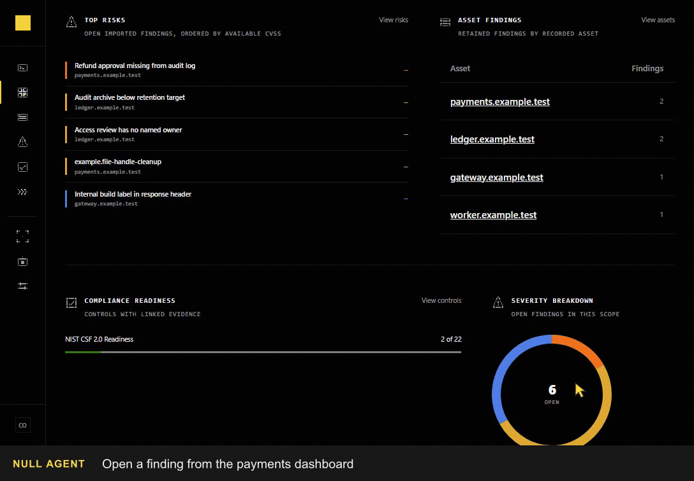
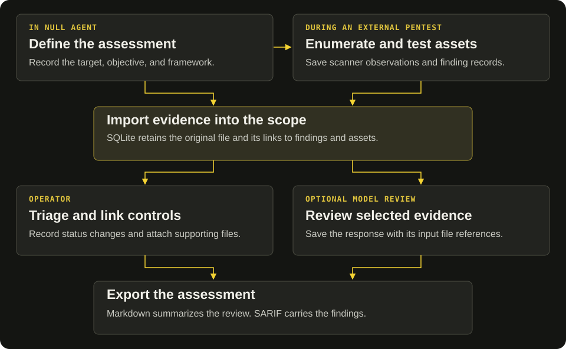
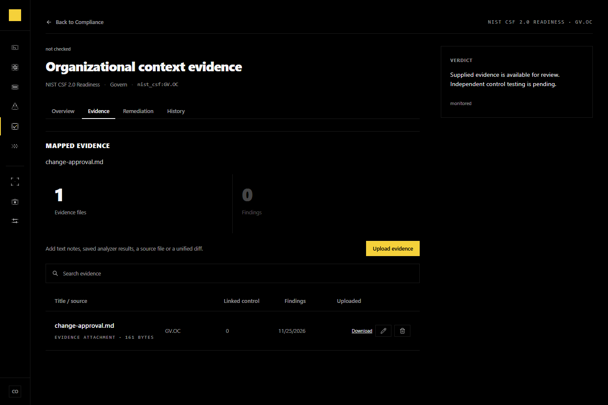

# Null Agent

Null Agent is a local browser workspace for security assessments. Bring in saved pentest findings, link control evidence, and ask your model to review the source behind a finding. The assessment and its original files stay in SQLite on your machine.

[](docs/images/payments-review.mp4)

**Watch one finding go through review.** The pointer, navigation, evidence import results, saved review, and Markdown export come from the running app. This payments workspace uses synthetic files and a simulated model response. [Play or download the MP4](docs/images/payments-review.mp4) · [View stills](#inside-the-payments-assessment)

[Install](#quick-start) · [Reproduce the demo](#first-assessment) · [Assessment lifecycle](#assessment-lifecycle) · [Connect a model](#connect-a-model)

## Quick start

Install **Node.js 22.18 or later** with npm, then clone and start the app.

```sh
git clone https://github.com/Null-Square/null-agent.git
cd null-agent
npm ci
npm start
```

Open [http://127.0.0.1:4317](http://127.0.0.1:4317). Create a local owner with an email and a password of at least eight characters. Add your organization and website in the setup wizard, then choose **Go to Console**. Importing evidence, browsing controls, triaging findings, and exporting reports work before you connect a model.

## First assessment

The recording follows a resource leak in the payments service. The analyzer points to `src/reader.js:3`. The source shows why it matters: the function opens a file, returns its contents, and leaves the handle open.

1. **Create the scope.** In **Scopes**, create **Payments service** and enter a review objective. Open its assessment.
2. **Load the evidence.** In **Compliance → Evidence Library**, import [payments-findings.jsonl](examples/payments-findings.jsonl), [review-results.json](examples/payments/review-results.json), and [reader.js](examples/payments/reader.js). These supply six findings across four assets. To reproduce the control evidence, select **NIST CSF**, attach [change-approval.md](examples/payments/change-approval.md) to `GV.OC` and [risk-register.md](examples/payments/risk-register.md) to `GV.RM`.
3. **Trace the finding.** In **Dashboard → Top risks**, open `example.file-handle-cleanup`. Under **Evidence**, choose **Preview original file**. Compare the recorded location and remediation with the source. Changing **Current status** adds an entry to **History**.
4. **Run a review.** Connect a provider under **Models**. In the assessment, choose **Open workbench → Code review**, select `reader.js` and `review-results.json`, then **Run review**. Open **History** to see which files the model received and what it returned.
5. **Take the results with you.** Under **Back to assessment → View report**, download the Markdown report with the latest review, or export the findings as SARIF. Triage, control linking, and exports also work before a model is connected.

## Assessment lifecycle



Scope and planning happen in the workspace. Enumeration and vulnerability discovery happen in the external testing tools that produce the imported records. Null Agent's backend parses those records into findings, preserves their source, and groups them by recorded asset. Each status change becomes part of the finding's history.

For compliance, a reviewer can attach a file to a control and inspect the original. For a model review, the operator selects the inputs in the workbench. Cloud reviews require confirmation before sending those inputs. The saved response references its evidence, so a reviewer can reopen it after a restart.

## Inside the payments assessment

**Which finding needs attention, and where?** This view of the dashboard puts the risk list beside the four affected assets. The severity breakdown below it reflects the six imported findings. The coverage count reflects evidence linked to controls in this scope.

[](docs/images/dashboard.png)

**What supports this control?** The evidence tab on the organizational context control shows the change approval attached to it. Open the record to inspect the original file.

[](docs/images/control-evidence.png)

## Connect a model

Open **Models** under **Setup**. Connect a provider, choose a model, and select **Test connection** for a small sample request. That test uses synthetic input. The chosen model is also available for evidence and code reviews from the workbench.

| Provider | Setup | Data used by the provider |
| --- | --- | --- |
| **Ollama** | Start Ollama on this computer, install a local text model, and choose **Ollama on this computer → Connect provider**. [Ollama CLI reference](https://docs.ollama.com/cli) | The selected review inputs go to Ollama at `127.0.0.1:11434`. |
| **ChatGPT plan** | Choose **Continue with ChatGPT** and authorize NullSquare through OpenAI with an eligible account. Return to **Models** to choose an available model. [OpenAI sign-in guide](https://developers.openai.com/siwc/token-sharing-open-source) | After your confirmation in the workbench, OpenAI receives the scope description and selected review inputs. |
| **OpenAI API** | Choose **OpenAI API**, paste a project API key, and click **Connect provider**. You can also set `NULLSQUARE_OPENAI_API_KEY` for the server process. [OpenAI API setup](https://developers.openai.com/api/docs/quickstart) | After your confirmation in the workbench, OpenAI receives the scope description and selected review inputs using your API account. |
| **Claude API** | **Continue with Claude** opens Claude Console for API key setup and selects **Claude API** in NullSquare. Paste the key and click **Connect provider**. [Claude API key setup](https://platform.claude.com/docs/en/get-api-key) | After your confirmation in the workbench, Anthropic receives the scope description and selected review inputs using your API account. |

Provider credentials are held in server memory for the session. Reconnect after a server restart.

## Local data and troubleshooting

| Setting or symptom | What to do |
| --- | --- |
| Workspace location | The default is `~/.nullsquare-local/workspace.sqlite`. Set `NULLSQUARE_DATA_DIR` to use another directory. |
| Backups | Stop NullSquare with **Ctrl+C** and copy the workspace directory, including any SQLite sidecar files. Restore it while the server is stopped. |
| Port already in use | Set `PORT` in the shell before `npm start`, then use the URL printed by the server. |
| No Ollama models listed | Start Ollama, check that a local model is installed, and connect again in **Models**. |
| File refused during import | Import supported analyzer JSON or JSONL, UTF-8 notes, or source excerpts and patches up to 8 KiB. To attach a document or other file up to 1 MiB, select a control in the Evidence Library. |
| Folder picker on Linux | Install Zenity and run the server in your desktop session to use **Select folder**. |
| Review exceeds the input budget | Select fewer records or smaller excerpts. A review accepts up to 12,000 bytes of prepared input. |

The browser edition is a single-user workspace protected by its local owner account. Review the contents of files and reports before sharing them.

## Development

```sh
npm ci
npx playwright install chromium
npm run verify:local
```

`npm run verify:local` builds the app, runs backend tests, and exercises the browser using a temporary SQLite workspace and simulated model responses. On Linux, use `npx playwright install --with-deps chromium` if Chromium’s system libraries are missing.

After building, run `node scripts/test-browser.mjs --capture` to refresh the demo screenshots. Add `--record` to capture the browser session and encode its captioned MP4 and looping GIF. Recording requires FFmpeg with libx264 and libass on your path.

The browser UI draws from the October 3 legacy checkpoint `2c8340798e8f776f438e377410ec3998887dacdf`. The local backend adapts the compliance and source review logic from `legacy/v3.2-final` at `981a70c4a3d81dd3885120ef0f1b11306035de49`.

[Contributing](CONTRIBUTING.md) · [Report a security issue](SECURITY.md) · [Apache 2.0 license](LICENSE)
