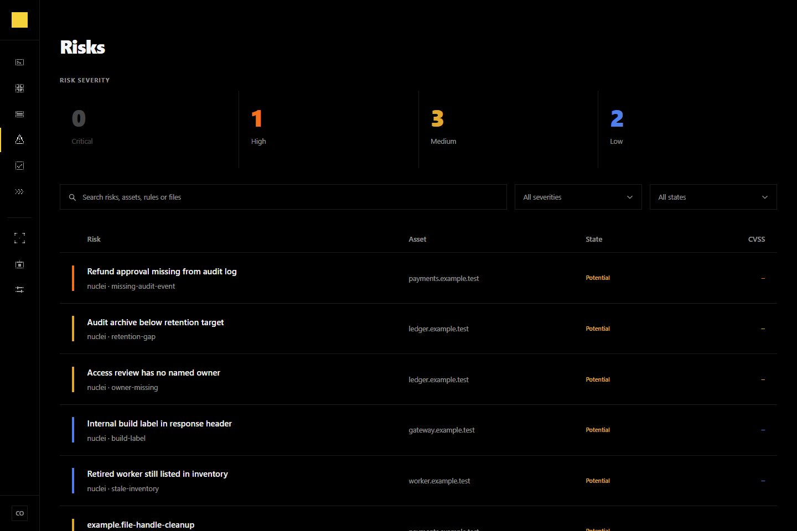
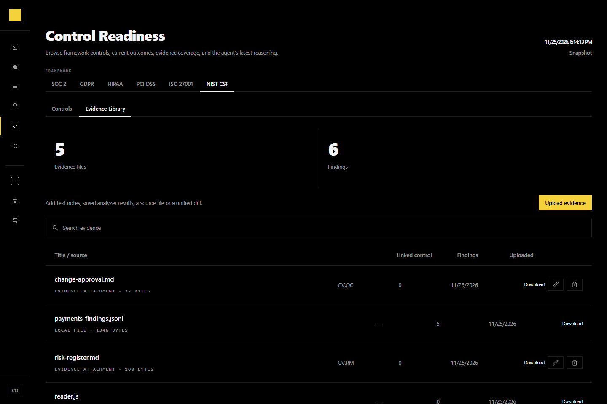
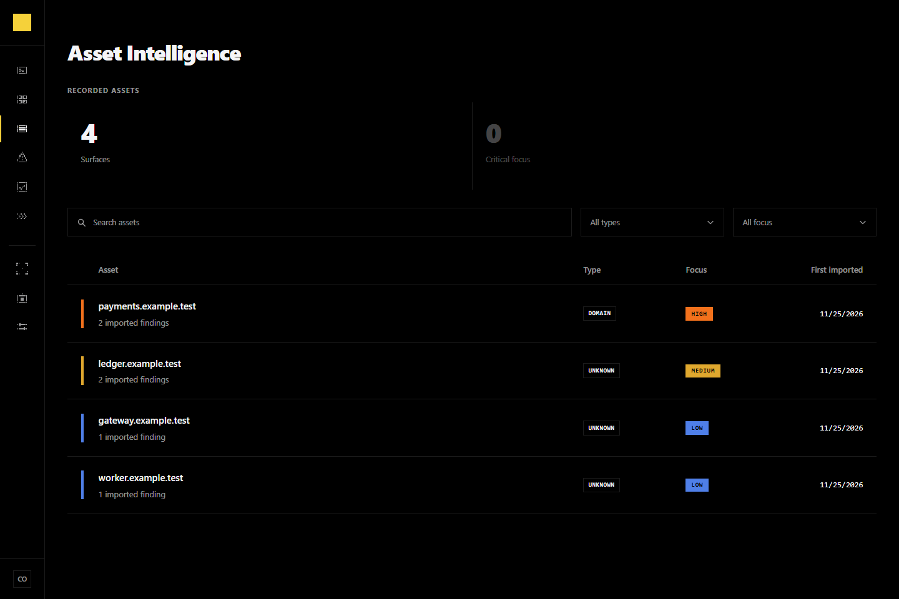
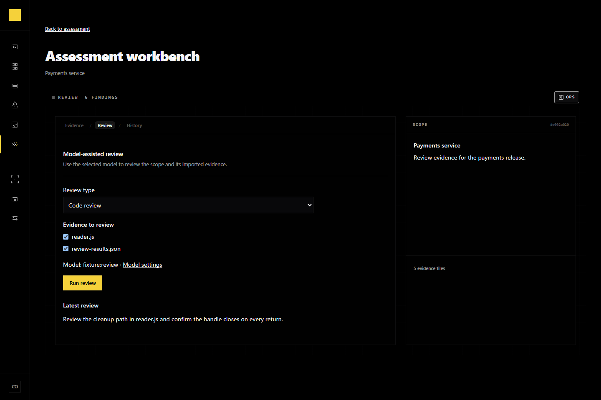
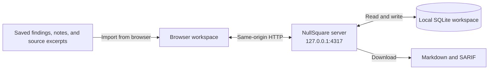
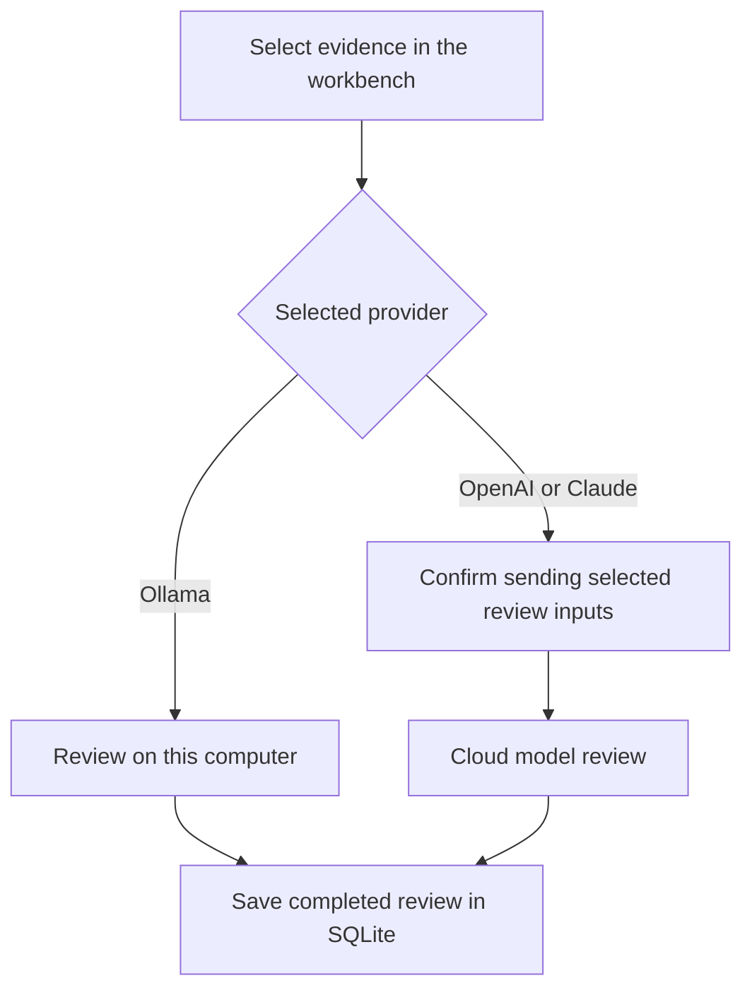

# Null Agent


Null Agent brings saved security findings, compliance records, and source changes into one local browser workspace. Open a finding, see which asset it belongs to, and follow the evidence into an assessment report. Connect a model when you want a second look at a file or patch.

[Install locally](#quick-start) · [Try the payments demo](#first-assessment) · [View stills](#screenshots) · [Connect a model](#connect-a-model) · [Architecture](#architecture)

## Quick start

Install **Node.js 22.18 or later** with npm, then clone and start the app.

```sh
git clone https://github.com/Null-Square/null-agent.git
cd null-agent
npm ci
npm start
```

Open [http://127.0.0.1:4317](http://127.0.0.1:4317). Create a local owner with an email and a password of at least eight characters. Add your organization and website in the setup wizard, then choose **Go to Console**. Importing evidence, browsing controls, triaging findings, and exporting reports work before you connect a model.

## First assessment

Try a review of the **Payments service** using the synthetic files included in this repository. You can complete the evidence and reporting steps as soon as onboarding finishes.

1. In **Scopes**, create a scope named **Payments service** and open its assessment. In **Compliance → Evidence Library**, upload [payments-findings.jsonl](examples/payments-findings.jsonl). The five saved findings describe four assets.
2. In **Risks**, open **Refund approval missing from audit log**. Read the evidence and remediation, set its status to **Confirmed**, and open **History** to see the change. In **Assets**, open `payments.example.test` to see the same finding from the asset’s perspective.
3. In **Compliance**, select **SOC 2**, expand **Access Control**, and open `CC6.2`. Under **Evidence**, upload [access-review.txt](examples/access-review.txt). Reopen the control to see the linked record. The workspace includes 176 controls across six frameworks.
4. In **Assessments**, open **Payments service** and select **View report**. Download **Markdown** for a reviewer or **SARIF** for a compatible tool.

For a code review, upload [audit-log.diff](examples/audit-log.diff), connect a model in **Models**, then choose **Open workbench → Code review** in the assessment. Select the patch and run the review. The saved result stays with the assessment.

## Screenshots

The animated cover and stills come from a local run using synthetic records. In addition to the five sample findings above, the captured workspace includes a sixth finding linked to `reader.js` and a simulated model response.

**The payments assessment at a glance.** Six open findings, four recorded assets, and five evidence files appear on the dashboard.

[](docs/images/dashboard.png)

| Triage a finding | Trace a control to its evidence |
| --- | --- |
| [](docs/images/risks-inbox.png) | [](docs/images/evidence-library.png) |
| [Finding detail and remediation](docs/images/finding-detail.png) | [Control readiness](docs/images/control-readiness.png) |

| Inspect an asset | Review a source change |
| --- | --- |
| [](docs/images/assets.png) | [](docs/images/code-review.png) |
| [Asset detail](docs/images/asset-detail.png) | [Model settings](docs/images/model-settings.png) |

## Connect a model

Open **Models** under **Setup**. Connect a provider, choose a model, and select **Test connection** for a small sample request. That test uses synthetic input. The chosen model is also available for evidence and code reviews from the workbench.

| Provider | Setup | Data used by the provider |
| --- | --- | --- |
| **Ollama** | Start Ollama on this computer, install a local text model, and choose **Ollama on this computer → Connect provider**. [Ollama CLI reference](https://docs.ollama.com/cli) | The selected review inputs go to Ollama at `127.0.0.1:11434`. |
| **ChatGPT plan** | Choose **Continue with ChatGPT** and authorize NullSquare through OpenAI with an eligible account. Return to **Models** to choose an available model. [OpenAI sign-in guide](https://developers.openai.com/siwc/token-sharing-open-source) | After your confirmation in the workbench, OpenAI receives the scope description and selected review inputs. |
| **OpenAI API** | Choose **OpenAI API**, paste a project API key, and click **Connect provider**. You can also set `NULLSQUARE_OPENAI_API_KEY` for the server process. [OpenAI API setup](https://developers.openai.com/api/docs/quickstart) | After your confirmation in the workbench, OpenAI receives the scope description and selected review inputs using your API account. |
| **Claude API** | **Continue with Claude** opens Claude Console for API key setup and selects **Claude API** in NullSquare. Paste the key and click **Connect provider**. [Claude API key setup](https://platform.claude.com/docs/en/get-api-key) | After your confirmation in the workbench, Anthropic receives the scope description and selected review inputs using your API account. |

Provider credentials are held in server memory for the session. Reconnect after a server restart.

## Architecture

The browser and API share one loopback server. SQLite stores imported originals, control mappings, finding history, and saved reviews.



A model review starts with an explicit evidence selection. The workbench saves completed reviews with the assessment. Control readiness reflects the available evidence and its limits.



## Local data and troubleshooting

| Setting or symptom | What to do |
| --- | --- |
| Workspace location | The default is `~/.nullsquare-local/workspace.sqlite`. Set `NULLSQUARE_DATA_DIR` to use another directory. |
| Backups | Stop NullSquare with **Ctrl+C** and copy the workspace directory, including any SQLite sidecar files. Restore it while the server is stopped. |
| Port already in use | Set `PORT` in the shell before `npm start`, then use the URL printed by the server. |
| No Ollama models listed | Start Ollama, check that a local model is installed, and connect again in **Models**. |
| File refused during import | Import supported analyzer JSON or JSONL, UTF-8 notes, or source excerpts and patches up to 8 KiB. To attach a document or other file up to 1 MiB, select a control in the Evidence Library. |
| Folder picker on Linux | Install Zenity and run the server in your desktop session to use **Select folder**. |
| Review exceeds the input budget | Select fewer records or smaller excerpts. A review accepts up to 12,000 bytes of prepared input. |

The browser edition is a single-user workspace protected by its local owner account. Review the contents of files and reports before sharing them.

## Development

```sh
npm ci
npx playwright install chromium
npm run verify:local
```

`npm run verify:local` builds the app, runs backend tests, and exercises the browser using a temporary SQLite workspace and simulated model responses. On Linux, use `npx playwright install --with-deps chromium` if Chromium’s system libraries are missing.

After a build, run `node scripts/test-browser.mjs --capture` to regenerate the demo stills. With FFmpeg on your path, run `node scripts/render-readme-cover.mjs` to rebuild the animated cover from the same capture.

The browser UI draws from the October 3 legacy checkpoint `2c8340798e8f776f438e377410ec3998887dacdf`. The local backend adapts the compliance and source review logic from `legacy/v3.2-final` at `981a70c4a3d81dd3885120ef0f1b11306035de49`.

[Contributing](CONTRIBUTING.md) · [Report a security issue](SECURITY.md) · [Apache 2.0 license](LICENSE)
