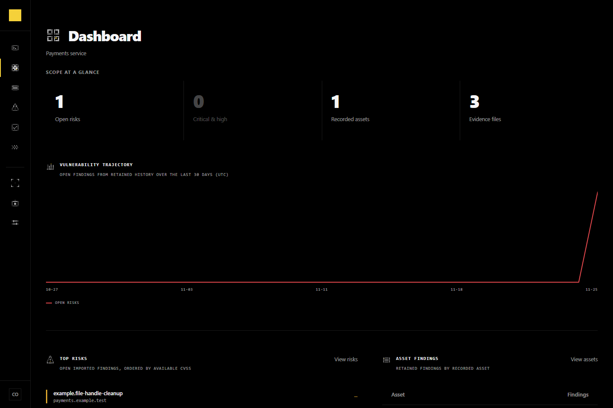
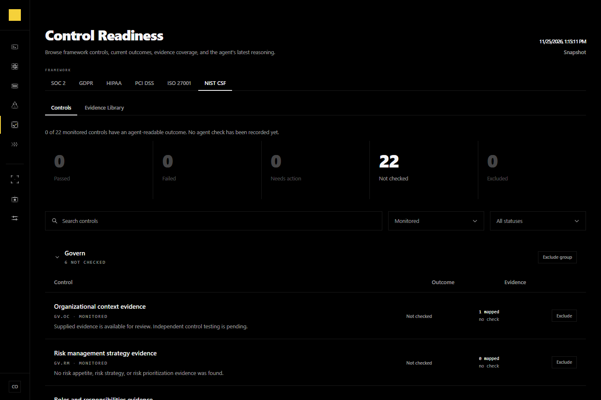
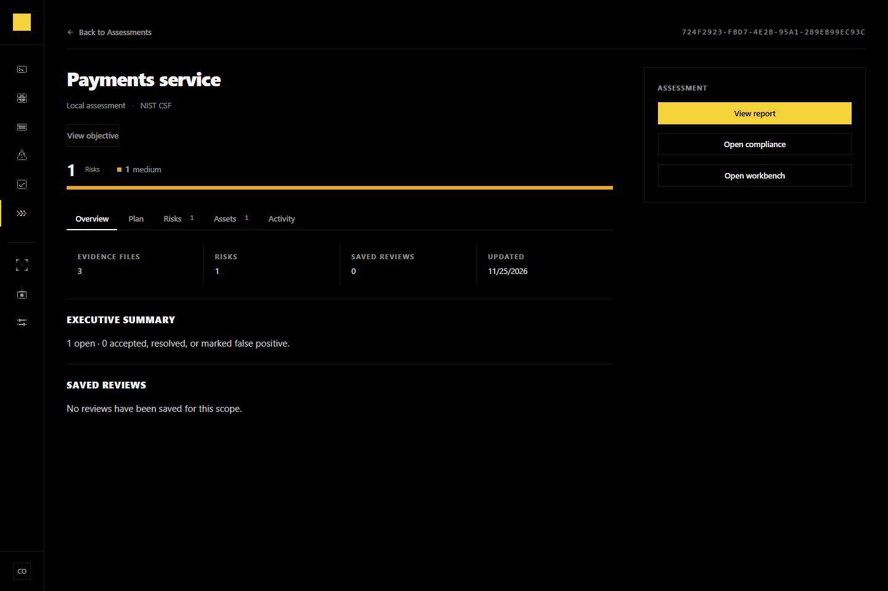
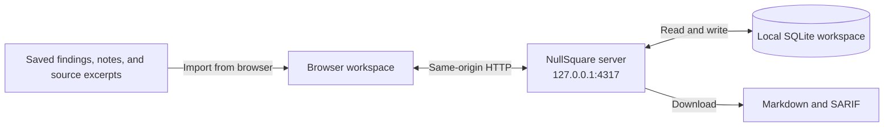
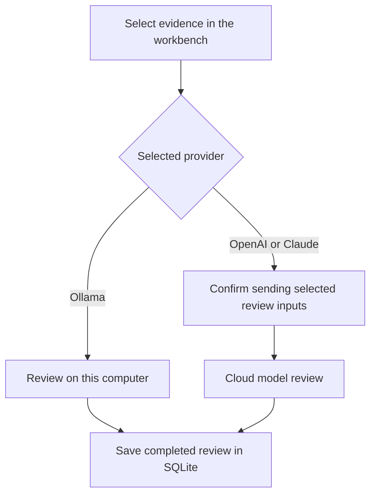

# Null Agent

Build an assessment from saved security findings, compliance evidence, and source changes. The NullSquare workspace runs in your browser, stores data in SQLite on your computer, and lets you choose when to use a model.

[Quick start](#quick-start) · [First assessment](#first-assessment) · [Screenshots](#screenshots) · [Connect a model](#connect-a-model) · [Architecture](#architecture)



## Quick start

Install **Node.js 22.18 or later** with npm, then clone and start the app.

```sh
git clone https://github.com/Null-Square/null-agent.git
cd null-agent
npm ci
npm start
```

Open [http://127.0.0.1:4317](http://127.0.0.1:4317). Create a local owner with an email and a password of at least eight characters. Add your organization and website in the setup wizard, then choose **Go to Console**. Importing evidence, browsing controls, triaging findings, and exporting reports work before you connect a model.

## What you can do

| Workflow | In NullSquare |
| --- | --- |
| Triage saved findings | Import supported analyzer output, filter the Risks inbox, open the evidence and remediation tabs, and record status changes. |
| Work from recorded assets | Open an asset to see the findings and assessments that refer to it. |
| Review compliance evidence | Browse 176 controls across SOC 2, ISO 27001, NIST CSF 2.0, GDPR, HIPAA, and PCI DSS v4.0.1. Attach evidence to a control and inspect traceable coverage. |
| Review a source change | Select a source excerpt or patch, run a text review with your model, and inspect the cited evidence. |
| Share assessment results | Download the Markdown report for people or a SARIF report for compatible tools. |

## First assessment

Use the included synthetic files to try the same workflow shown in the screenshots.

1. **Choose a scope.** Setup creates the first scope and records the website under **Targets**. To use a separate scope for the sample files, select **New scope**, name it `Inventory service`, and add a short description.
2. **Attach a control record.** In **Compliance**, select **SOC 2**, expand **Access Control**, and open `CC6.2`. Go to **Evidence → Upload evidence** and choose [access-review.txt](examples/access-review.txt).
3. **Triage a saved finding.** In **Compliance → Evidence Library**, upload [saved-assessment.jsonl](examples/saved-assessment.jsonl). Open **Risks**, select the finding, and inspect its **Evidence** and **Remediation** tabs. Change **Current status** and check **History**.
4. **Export the assessment.** Open the scope from **Assessments**, select **View report**, and download the Markdown or SARIF report.

To try a source review, upload [audit-log.diff](examples/audit-log.diff) through the Evidence Library and [connect a model](#connect-a-model). From the assessment, select **Open workbench**, choose **Code review**, select the patch, and click **Run review**.

## Screenshots

| Findings and remediation | Compliance control readiness |
| --- | --- |
| [](docs/images/risks-inbox.png) | [](docs/images/control-readiness.png) |
| [Finding detail](docs/images/finding-detail.png) | [Evidence Library](docs/images/evidence-library.png) |

| Assessment workspace | Code review workbench |
| --- | --- |
| [](docs/images/assessment-overview.png) | [](docs/images/code-review.png) |
| [Assessment history](docs/images/assessment-history.png) · [Asset inventory](docs/images/assets.png) · [Asset detail](docs/images/asset-detail.png) | [Model settings](docs/images/model-settings.png) |

The screenshots were captured from the browser test with synthetic files and sample model responses.

## Connect a model

Open **Models** under **Setup**. Connect a provider, choose a model, and select **Test connection** for a small sample request. That test uses synthetic input. The chosen model is also available for evidence and code reviews from the workbench.

| Provider | Setup | Data used by the provider |
| --- | --- | --- |
| **Ollama** | Start Ollama on this computer, install a local text model, and choose **Ollama on this computer → Connect provider**. [Ollama CLI reference](https://docs.ollama.com/cli) | The selected review inputs go to Ollama at `127.0.0.1:11434`. |
| **ChatGPT plan** | Choose **Continue with ChatGPT** and authorize NullSquare through OpenAI with an eligible account. Return to **Models** to choose an available model. [OpenAI sign-in guide](https://developers.openai.com/siwc/token-sharing-open-source) | After your confirmation in the workbench, OpenAI receives the scope description and selected review inputs. |
| **OpenAI API** | Choose **OpenAI API**, paste a project API key, and click **Connect provider**. You can also set `NULLSQUARE_OPENAI_API_KEY` for the server process. [OpenAI API setup](https://developers.openai.com/api/docs/quickstart) | After your confirmation in the workbench, OpenAI receives the scope description and selected review inputs using your API account. |
| **Claude API** | **Continue with Claude** opens Claude Console for API key setup and selects **Claude API** in NullSquare. Paste the key and click **Connect provider**. [Claude API key setup](https://platform.claude.com/docs/en/get-api-key) | After your confirmation in the workbench, Anthropic receives the scope description and selected review inputs using your API account. |

Provider credentials are held in server memory for the session. Reconnect after a server restart.

## Architecture

The browser and API share one loopback server. SQLite stores imported originals, control mappings, finding history, and saved reviews.



A model review starts with an explicit evidence selection. The workbench saves completed reviews with the assessment. Control readiness reflects the available evidence and its limits.



## Local data and troubleshooting

| Setting or symptom | What to do |
| --- | --- |
| Workspace location | The default is `~/.nullsquare-local/workspace.sqlite`. Set `NULLSQUARE_DATA_DIR` to use another directory. |
| Backups | Stop NullSquare with **Ctrl+C** and copy the workspace directory, including any SQLite sidecar files. Restore it while the server is stopped. |
| Port already in use | Set `PORT` in the shell before `npm start`, then use the URL printed by the server. |
| No Ollama models listed | Start Ollama, check that a local model is installed, and connect again in **Models**. |
| File refused during import | Import supported analyzer JSON or JSONL, UTF-8 notes, or source excerpts and patches up to 8 KiB. To attach a document or other file up to 1 MiB, select a control in the Evidence Library. |
| Folder picker on Linux | Install Zenity and run the server in your desktop session to use **Select folder**. |
| Review exceeds the input budget | Select fewer records or smaller excerpts. A review accepts up to 12,000 bytes of prepared input. |

The browser edition is a single-user workspace protected by its local owner account. Review the contents of files and reports before sharing them.

## Development

```sh
npm ci
npx playwright install chromium
npm run verify:local
```

`npm run verify:local` builds the app, runs backend tests, and exercises the browser using a temporary SQLite workspace and simulated model responses. On Linux, use `npx playwright install --with-deps chromium` if Chromium’s system libraries are missing.

To regenerate the screenshots after a build, run `node scripts/test-browser.mjs --capture`.

The browser UI draws from the October 3 legacy checkpoint `2c8340798e8f776f438e377410ec3998887dacdf`. The local backend adapts the compliance and source review logic from `legacy/v3.2-final` at `981a70c4a3d81dd3885120ef0f1b11306035de49`.

[Contributing](CONTRIBUTING.md) · [Report a security issue](SECURITY.md) · [Apache 2.0 license](LICENSE)
