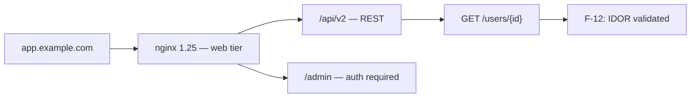
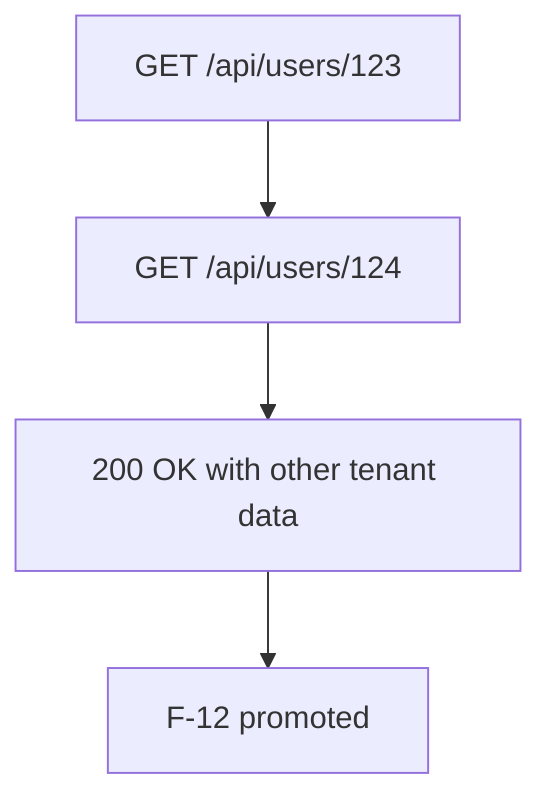
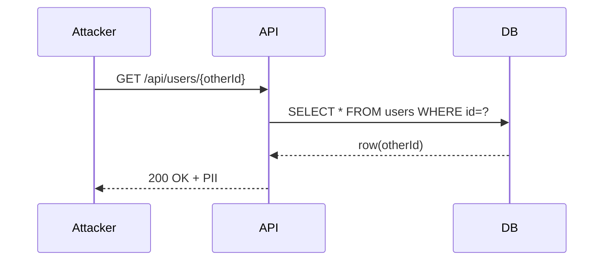

# Security Reporting Methodology

Reporting is the closeout phase. By the time you reach it, testing missions
have produced findings (validated and candidate), evidence artifacts, HTTP
exchanges, and `report_note` records. Your job is to turn that canonical
state into a pentest-shaped deliverable the operator, management, and
remediation owners can act on.

`report_finalizer_preflight` tells you whether final closeout can pass before
you draft. `prepare_report_context` writes the durable source package for
reporting. You then author `summary.md` and `report.md` manually. The
finalizer validates and publishes those files; it does not render the report
skeleton or invent analyst prose. Add diagrams only when they clarify real
evidence.

## 1. Inventory Canonical State First

Before writing any section, read the canonical state. Without this you will
write generic prose that does not map to the actual run.

```
query_findings({ status: "all", severity: "all" })
query_inventory({ assetKind: "all", includeServices: true, includeEndpoints: true })
query_notes({ ntype: "approach.tried" })
query_notes({ ntype: "approach.blocker" })
query_notes({ ntype: "scan.coverage" })
report_finalizer_preflight({})
prepare_report_context({ detail: "brief" })
```

For every section you plan to write, identify the specific finding IDs,
note titles, HTTP exchange IDs, or artifact paths you will cite. If you
cannot cite anything, do not write that section.

If preflight returns `canFinalizeFinal=false`, write an interim closeout.
Name the blockers from `finalizerBlockers`, include the required next
prerequisites in `run.digest`, and call `finalize_run_artifacts` with
`mode="interim"`.

Read `.artifacts/report/brief.md` after calling `prepare_report_context`.
Use `.artifacts/report/context.json` only when you need the raw supporting
data. Do not paste scanner command dumps or shell job indexes into the final
report unless they are directly relevant evidence.

## 2. Suggested Report Sections

Use these slugs for optional `report.section` notes when a long run needs
durable narrative fragments. The finalizer does not map them into the final
report. You author `summary.md` and `report.md` directly from the prepared
context and useful notes.

### `executive-summary` → §1. Executive Summary

Audience: management, asset owner. 4–8 sentences. Cover:

- What was tested (scope, target, run goal in plain language).
- Posture verdict (e.g., "one validated high-severity issue, no critical
  findings, attack surface understood and well-segmented").
- Top one or two findings, by severity, named without jargon.
- Overall recommendation in business terms (e.g., "remediate F-12 before
  the auth refresh, then schedule a focused IDOR re-test").

Avoid: tool names, raw HTTP, CVE numbers, run-internal labels.
Cite: top finding IDs in `evidence_refs`.

Bad: "The assessment reviewed the target for common vulnerabilities."
Good: "The run tested the public web tier of `app.example.com`. One
validated low-severity issue (missing security headers) was found; the
authentication wall held against header-bypass and IDOR probing. Recommend
fixing F-12 in the next deployment and scheduling an authenticated scope
re-test once a test account is provisioned."

### `methodology` → §3. Engagement Methodology

Audience: technical reviewer. Cover:

- Plan phases (recon → mapping → class testing → validation → closeout)
  and which phases this run actually executed.
- Skills exercised and why (e.g., `idor`, `sql-injection`, `js-surface-analysis`).
- Manual techniques and scanners used. Note scanner outcomes that mattered.
- Pivots: when an approach blocked and what replaced it.

Cite: `approach.tried` note titles, scanner job IDs, `scan.coverage` note
titles.

### `attack-surface` → §4. Attack Surface Overview

Audience: technical reviewer. Cover:

- Hosts and services in scope, with technology fingerprints worth noting.
- Auth boundaries observed (anonymous, user, admin, internal-only).
- Trust boundaries between services or tenants.
- API roots, important endpoint families, and what they expose.

Cite: asset IDs, `tech.fingerprint` notes, `http.endpoint` notes.
Diagram: an attack-surface map often clarifies this section (template
below).

### `findings-narrative` → §5. Findings — Detailed Analysis (above per-finding rows)

Audience: technical reviewer. Cover **synthesis only**, not per-finding
restatement:

- Themes across findings (e.g., "three findings share a missing
  authorization check at the controller layer").
- Chained risk (e.g., "F-12 + F-15 together allow tenant escape").
- Root-cause patterns and where to fix them once.

Do not restate Business Impact, Technical Analysis, or PoC for a single
finding in a durable note. Put only necessary per-finding detail into the
authored `report.md`.

Cite: finding IDs of the related cluster.

### `limitations` → §6. Limitations and Coverage Debt

Audience: management, follow-up planner. Cover:

- Blocked tests with reason (missing credentials, network origin,
  unavailable test data, time budget).
- Untested classes that should have been tested but were not.
- Scanner failures or timeouts and what they would have covered.
- Coverage debts the next run should pick up.

Cite: `approach.blocker` note titles, `scan.coverage` notes with
status="blocked", scanner job IDs.

### `remediation-plan` → §7. Remediation Plan

Audience: remediation owner. Cover:

- Prioritized fix sequence — what to do first and why.
- Quick wins vs. structural fixes.
- Dependencies between fixes (fix A unblocks finding B's mitigation).
- Ownership hints when the codebase or repo trail makes it obvious.

Do not restate every per-finding remediation item in a durable note. This
section is the *cross-finding* fix plan that should shape the authored report.

Cite: finding IDs in priority order.

### `next-steps` → §8. Next Steps

Audience: next-run planner. One concrete next-run objective the agent can
execute inside the approved scope:

- Class to test and target to test it on.
- Why this path is the highest-value pentest move from the current evidence.
- Coverage debt, candidate finding, technology, route, parameter, or chain
  hypothesis that makes the path likely to produce a finding.
- Not "continue testing" or "do more assessment".
- Not remediation, patching, credential provisioning, account creation, or any
  other operator/customer action.

Cite: open candidate finding IDs, coverage debt notes, `approach.blocker`
titles for limitations, and the run.digest recommendation when present.

## 3. Evidence Citation Patterns

`evidence_refs` accepts free-form strings. Use these conventions:

- Finding ID: `f_01HV3...` (the canonical finding row id)
- Note title: `"approach.tried: idor on /api/users/{id}"`
- HTTP exchange: `"http://finding-1/baseline"` (the displayPath preserved in
  report context)
- Artifact path: `".artifacts/nuclei.json"`

A section without `evidence_refs` is still stored, but it is weak source
material. Treat citations as part of the section, not an afterthought.

## 4. When to Add a Mermaid Diagram

Diagrams should clarify actual evidence, not decorate the report. Use them
inside the matching section, not as standalone sections. Label nodes with
real hosts, endpoints, finding IDs, note titles, or artifact names from
this run.

Attack-surface map (inside `attack-surface`):

````markdown

````

Evidence-flow map (inside `findings-narrative`):

````markdown

````

Validation sequence (inside `findings-narrative` for chained risk):

````markdown

````

Skip the diagram if the relationship is trivial or already obvious from the
findings table.

## 5. Write The Run Digest

After all sections are written, create exactly one `run.digest`:

- `goal`: the actual run goal and target.
- `outcome`: `completed`, `partially_completed`, or `blocked` — must match
  the final task state.
- `recommendation`: optional; one concrete next assessment objective naming
  target and technique. It must be executable by the agent with current scope
  data and tools.
- `blocker_summary`: only when materially blocked; specific.
- `completed_tasks`, `blocked_tasks`, `next_prerequisites`: tied to
  approved plan tasks and recorded blockers.

Choose the recommendation like a pentester deciding where the next run is
most likely to produce validated findings:

- Prefer untested or under-mapped surfaces before repeating broad recon.
- Prefer targeted vulnerability-class testing on known assets when recon is
  already good enough.
- Prefer validating high-signal candidates when enough evidence exists.
- Prefer chain hypotheses when multiple facts can reasonably combine into a
  stronger test path.
- Put missing credentials, tokens, accounts, network origin, or customer-side
  actions in `next_prerequisites`; do not make them the recommendation.
- If no agent-actionable path remains, omit `recommendation` and write the
  blocker/prerequisites clearly.

The next planner reads `run.digest` first. A remediation-focused or vague
recommendation makes the next run wrong or vague.

## 6. Author The Final Files

Write `summary.md` as a compact operator closeout:

- Outcome and assessment state.
- Reportable finding count by severity.
- Key result bullets.
- The single recommended next run.
- Any material blocker or prerequisite.

Write `report.md` as the polished assessment deliverable:

- Executive summary.
- Scope and methodology actually used.
- Attack surface or tested boundary.
- Findings narrative and per-finding details when findings exist.
- Limitations and coverage debt.
- Remediation plan when findings exist.
- Next steps.

Appendices are optional. Prefer linking or naming `.artifacts/report/context.json`
over embedding long scanner logs, shell job IDs, or raw command output.

## 7. Finalize

Use the result from `report_finalizer_preflight` to choose final or interim
mode before drafting. Call `finalize_run_artifacts` only after findings,
coverage notes, the relevant `report.section` notes, `run.digest`,
`summary.md`, and `report.md` are complete.

- `mode="final"` — all approved plan tasks are completed and every
  promote-eligible finding is promoted.
- `mode="interim"` — partial or blocked. Provide a specific `reason`
  (e.g., "credential set X not provided; auth path testing blocked").

## 8. Reviewer Checklist

Before calling `finalize_run_artifacts`, walk this list:

- [ ] Every section I wrote has at least one `evidence_refs` entry.
- [ ] No section restates per-finding fields (Business Impact, PoC, etc.).
- [ ] Every claim ties to a finding ID, note title, HTTP exchange, or
      artifact path.
- [ ] `run.digest.recommendation`, when present, is an agent-actionable
      assessment objective with target and technique, not remediation,
      credential provisioning, or a generic phrase.
- [ ] If I skipped a section, the reason is "no evidence to back it" —
      not "ran out of time".
- [ ] If I added a Mermaid diagram, it clarifies a relationship the
      findings table cannot show.
- [ ] `summary.md` is concise and does not include appendices.
- [ ] `report.md` reads like an authored deliverable, not a dump of
      `.artifacts/report/context.json`.

## B1 Existing-Package Contract

This appendix normalizes the existing package; the package-specific procedure above remains authoritative.

### Preconditions and Fast Applicability

Confirm the exact target or artifact is authorized, the package-specific input exists, and the earlier procedure's controls and quantitative limits can be met. Otherwise record not-applicable or blocked coverage.

### Surface Discovery and Prioritization

Start from durable inventory and prioritize only the surfaces named by this package. A technology, route, banner, or version string establishes inventory, not a vulnerability.

### Safe Test Ladder

Run the package's baseline first, then its smallest one-variable candidate and a matched negative control. Stop at proof, falsification, the package cap, or a missing prerequisite.

### Variation Matrix

Apply only variations justified by the observed parser, identity, state, transport, platform, or tool behavior. Change one dimension per replay and retain the invariant baseline.

### Proof Standard

Use the package-specific proof floor above. Scanner labels, generic errors, reflection, timing outliers, and source appearance remain leads unless the documented control and impact are reproduced.

### False Positives and Benign Lookalikes

Compare the candidate with a normal baseline, a syntax-neutral or nonexistent control, and any package-specific benign condition. Reject results that are equally explained by caching, rate limiting, intended public behavior, or unstable infrastructure.

### Missing Prerequisites and Blocked Behavior

Name the missing identity, state, protocol support, repository context, callback, or safe environment and the exact evidence that would unblock testing. Never convert blocked or ambiguous work into a finding.

### Tool Selection and Fallback

Use only the tools declared by this skill and prefer machine-readable, rate-bounded output. If the preferred tool is unavailable, use the package's documented fallback or stop; do not broaden permissions.

### Handoffs and Duplicate Prevention

Keep this package focused on its declared primitive. Reuse baseline and evidence identifiers when a related skill owns another protocol, platform, or final validation decision.

### Stop, Cleanup, and Data Minimization

Stop at the first sufficient proof or rejection. Remove evaluator-created state, expire callbacks, close special connections, redact secrets and personal data, and retain only the minimum reproducible evidence. Never perform destructive actions or expand beyond the authorized target.

Research date: 2026-07-23

## Sources

- Package-specific sources and references listed above.
- Locked B1 authoring and evaluation PRD: ../../../../../docs/prd/3.0/agent-skill-authoring-and-evaluation.md
